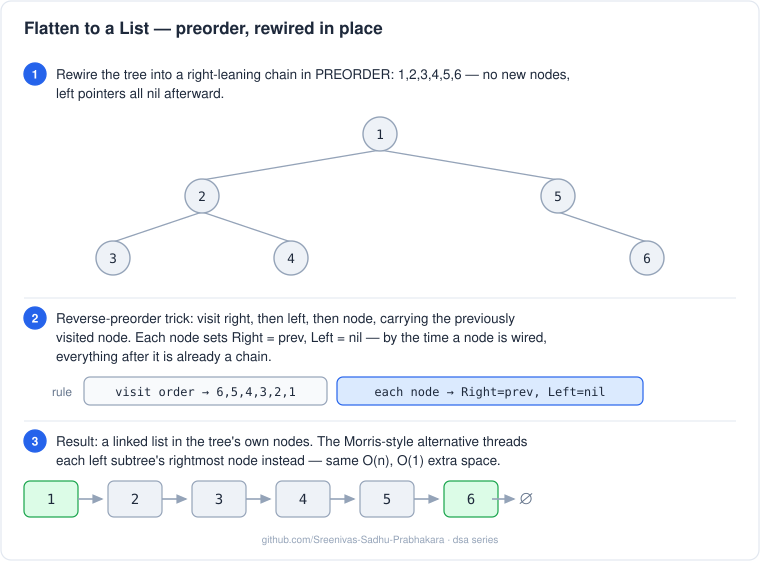

# Flatten Binary Tree to Linked List

> Striver SDE Sheet 128 · Day 19 Binary Tree III — visit in reverse preorder and thread each node to the one visited before it; the chain assembles back to front. Go, stdlib only, tested.

## Problem

Rearrange a binary tree, in place, into a "linked list": every `Left` nil, `Right` pointers forming the tree's preorder sequence.

## Approach

Building the chain front to back fights the structure (you'd overwrite children you still need). Build it **back to front** instead: traverse in reverse preorder — right subtree, left subtree, root — and make each visited node point its `Right` at the previously visited node (`prev`), nil its `Left`, and become the new `prev`. By the time any node is rewired, both of its subtrees have already been chained, so nothing is lost. Four lines of body; the elegance is entirely in choosing the traversal order that makes mutation safe. (The O(1)-space alternative is a Morris-style rewiring: splice each left subtree between the node and its right child.)

**Complexity:** O(n) time, O(h) recursion.

## Visual walkthrough

Read the picture top to bottom — each numbered frame is one moment of the algorithm
running on this repo's test example.

## Run

    go test ./...   # verify
    go run .        # demo

---

One of 191 repos solving Striver's SDE Sheet in Go — stdlib only, one problem per repo, every solution tested. Browse the set: [`dsa-*` repos](https://github.com/Sreenivas-Sadhu-Prabhakara?tab=repositories&q=dsa-&type=source).
